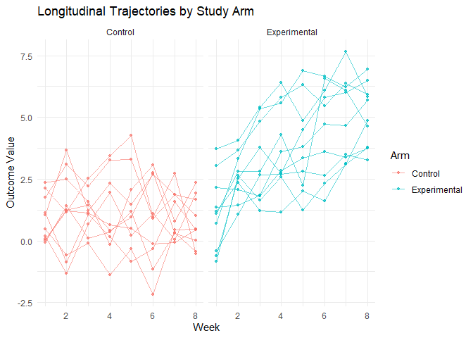
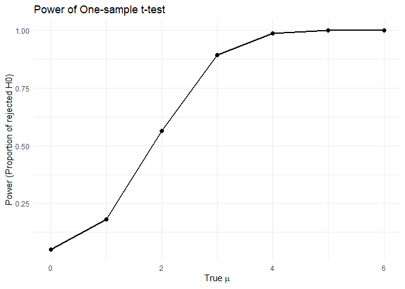
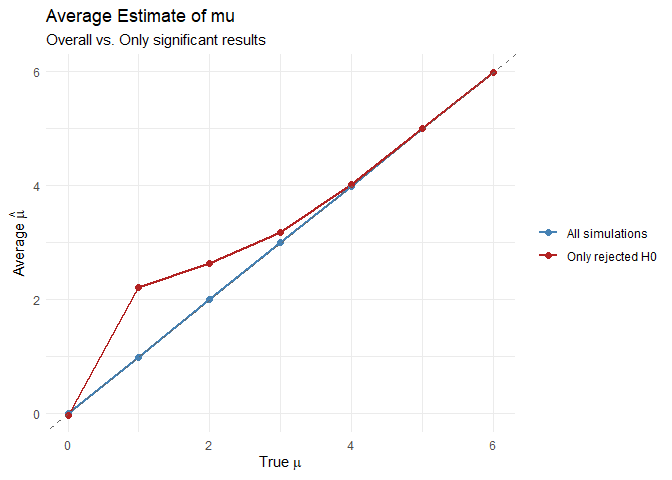

p8105_hw5_zl3804.Rmd
================
Zhuoxuan Li (Eva)
2026-11-18

``` r
library(tidyverse)
```

    ## ── Attaching core tidyverse packages ──────────────────────── tidyverse 2.0.0 ──
    ## ✔ dplyr     1.2.1     ✔ readr     2.2.0
    ## ✔ forcats   1.0.1     ✔ stringr   1.6.0
    ## ✔ ggplot2   4.0.3     ✔ tibble    3.3.1
    ## ✔ lubridate 1.9.5     ✔ tidyr     1.3.2
    ## ✔ purrr     1.2.2     
    ## ── Conflicts ────────────────────────────────────────── tidyverse_conflicts() ──
    ## ✖ dplyr::filter() masks stats::filter()
    ## ✖ dplyr::lag()    masks stats::lag()
    ## ℹ Use the conflicted package (<http://conflicted.r-lib.org/>) to force all conflicts to become errors

# Prob 1

``` r
birthdays= sample(1:365,size=5,replace = TRUE)

repeated_birthdays = length(unique(birthdays))<5

repeated_birthdays
```

    ## [1] FALSE

turn into function run it a bunch

``` r
source("source/birthday_repeated.R")

birthday_repeated(147)
```

    ## [1] TRUE

# Prob 2

``` r
file_df = 
  tibble(
  file_path = list.files("data", pattern = "\\.csv$", full.names = TRUE)
)


file_df = file_df |> 
  mutate(
    data = map(file_path, read_csv)
  )
```

    ## Rows: 1 Columns: 8
    ## ── Column specification ────────────────────────────────────────────────────────
    ## Delimiter: ","
    ## dbl (8): week_1, week_2, week_3, week_4, week_5, week_6, week_7, week_8
    ## 
    ## ℹ Use `spec()` to retrieve the full column specification for this data.
    ## ℹ Specify the column types or set `show_col_types = FALSE` to quiet this message.
    ## Rows: 1 Columns: 8
    ## ── Column specification ────────────────────────────────────────────────────────
    ## Delimiter: ","
    ## dbl (8): week_1, week_2, week_3, week_4, week_5, week_6, week_7, week_8
    ## 
    ## ℹ Use `spec()` to retrieve the full column specification for this data.
    ## ℹ Specify the column types or set `show_col_types = FALSE` to quiet this message.
    ## Rows: 1 Columns: 8
    ## ── Column specification ────────────────────────────────────────────────────────
    ## Delimiter: ","
    ## dbl (8): week_1, week_2, week_3, week_4, week_5, week_6, week_7, week_8
    ## 
    ## ℹ Use `spec()` to retrieve the full column specification for this data.
    ## ℹ Specify the column types or set `show_col_types = FALSE` to quiet this message.
    ## Rows: 1 Columns: 8
    ## ── Column specification ────────────────────────────────────────────────────────
    ## Delimiter: ","
    ## dbl (8): week_1, week_2, week_3, week_4, week_5, week_6, week_7, week_8
    ## 
    ## ℹ Use `spec()` to retrieve the full column specification for this data.
    ## ℹ Specify the column types or set `show_col_types = FALSE` to quiet this message.
    ## Rows: 1 Columns: 8
    ## ── Column specification ────────────────────────────────────────────────────────
    ## Delimiter: ","
    ## dbl (8): week_1, week_2, week_3, week_4, week_5, week_6, week_7, week_8
    ## 
    ## ℹ Use `spec()` to retrieve the full column specification for this data.
    ## ℹ Specify the column types or set `show_col_types = FALSE` to quiet this message.
    ## Rows: 1 Columns: 8
    ## ── Column specification ────────────────────────────────────────────────────────
    ## Delimiter: ","
    ## dbl (8): week_1, week_2, week_3, week_4, week_5, week_6, week_7, week_8
    ## 
    ## ℹ Use `spec()` to retrieve the full column specification for this data.
    ## ℹ Specify the column types or set `show_col_types = FALSE` to quiet this message.
    ## Rows: 1 Columns: 8
    ## ── Column specification ────────────────────────────────────────────────────────
    ## Delimiter: ","
    ## dbl (8): week_1, week_2, week_3, week_4, week_5, week_6, week_7, week_8
    ## 
    ## ℹ Use `spec()` to retrieve the full column specification for this data.
    ## ℹ Specify the column types or set `show_col_types = FALSE` to quiet this message.
    ## Rows: 1 Columns: 8
    ## ── Column specification ────────────────────────────────────────────────────────
    ## Delimiter: ","
    ## dbl (8): week_1, week_2, week_3, week_4, week_5, week_6, week_7, week_8
    ## 
    ## ℹ Use `spec()` to retrieve the full column specification for this data.
    ## ℹ Specify the column types or set `show_col_types = FALSE` to quiet this message.
    ## Rows: 1 Columns: 8
    ## ── Column specification ────────────────────────────────────────────────────────
    ## Delimiter: ","
    ## dbl (8): week_1, week_2, week_3, week_4, week_5, week_6, week_7, week_8
    ## 
    ## ℹ Use `spec()` to retrieve the full column specification for this data.
    ## ℹ Specify the column types or set `show_col_types = FALSE` to quiet this message.
    ## Rows: 1 Columns: 8
    ## ── Column specification ────────────────────────────────────────────────────────
    ## Delimiter: ","
    ## dbl (8): week_1, week_2, week_3, week_4, week_5, week_6, week_7, week_8
    ## 
    ## ℹ Use `spec()` to retrieve the full column specification for this data.
    ## ℹ Specify the column types or set `show_col_types = FALSE` to quiet this message.
    ## Rows: 1 Columns: 8
    ## ── Column specification ────────────────────────────────────────────────────────
    ## Delimiter: ","
    ## dbl (8): week_1, week_2, week_3, week_4, week_5, week_6, week_7, week_8
    ## 
    ## ℹ Use `spec()` to retrieve the full column specification for this data.
    ## ℹ Specify the column types or set `show_col_types = FALSE` to quiet this message.
    ## Rows: 1 Columns: 8
    ## ── Column specification ────────────────────────────────────────────────────────
    ## Delimiter: ","
    ## dbl (8): week_1, week_2, week_3, week_4, week_5, week_6, week_7, week_8
    ## 
    ## ℹ Use `spec()` to retrieve the full column specification for this data.
    ## ℹ Specify the column types or set `show_col_types = FALSE` to quiet this message.
    ## Rows: 1 Columns: 8
    ## ── Column specification ────────────────────────────────────────────────────────
    ## Delimiter: ","
    ## dbl (8): week_1, week_2, week_3, week_4, week_5, week_6, week_7, week_8
    ## 
    ## ℹ Use `spec()` to retrieve the full column specification for this data.
    ## ℹ Specify the column types or set `show_col_types = FALSE` to quiet this message.
    ## Rows: 1 Columns: 8
    ## ── Column specification ────────────────────────────────────────────────────────
    ## Delimiter: ","
    ## dbl (8): week_1, week_2, week_3, week_4, week_5, week_6, week_7, week_8
    ## 
    ## ℹ Use `spec()` to retrieve the full column specification for this data.
    ## ℹ Specify the column types or set `show_col_types = FALSE` to quiet this message.
    ## Rows: 1 Columns: 8
    ## ── Column specification ────────────────────────────────────────────────────────
    ## Delimiter: ","
    ## dbl (8): week_1, week_2, week_3, week_4, week_5, week_6, week_7, week_8
    ## 
    ## ℹ Use `spec()` to retrieve the full column specification for this data.
    ## ℹ Specify the column types or set `show_col_types = FALSE` to quiet this message.
    ## Rows: 1 Columns: 8
    ## ── Column specification ────────────────────────────────────────────────────────
    ## Delimiter: ","
    ## dbl (8): week_1, week_2, week_3, week_4, week_5, week_6, week_7, week_8
    ## 
    ## ℹ Use `spec()` to retrieve the full column specification for this data.
    ## ℹ Specify the column types or set `show_col_types = FALSE` to quiet this message.
    ## Rows: 1 Columns: 8
    ## ── Column specification ────────────────────────────────────────────────────────
    ## Delimiter: ","
    ## dbl (8): week_1, week_2, week_3, week_4, week_5, week_6, week_7, week_8
    ## 
    ## ℹ Use `spec()` to retrieve the full column specification for this data.
    ## ℹ Specify the column types or set `show_col_types = FALSE` to quiet this message.
    ## Rows: 1 Columns: 8
    ## ── Column specification ────────────────────────────────────────────────────────
    ## Delimiter: ","
    ## dbl (8): week_1, week_2, week_3, week_4, week_5, week_6, week_7, week_8
    ## 
    ## ℹ Use `spec()` to retrieve the full column specification for this data.
    ## ℹ Specify the column types or set `show_col_types = FALSE` to quiet this message.
    ## Rows: 1 Columns: 8
    ## ── Column specification ────────────────────────────────────────────────────────
    ## Delimiter: ","
    ## dbl (8): week_1, week_2, week_3, week_4, week_5, week_6, week_7, week_8
    ## 
    ## ℹ Use `spec()` to retrieve the full column specification for this data.
    ## ℹ Specify the column types or set `show_col_types = FALSE` to quiet this message.
    ## Rows: 1 Columns: 8
    ## ── Column specification ────────────────────────────────────────────────────────
    ## Delimiter: ","
    ## dbl (8): week_1, week_2, week_3, week_4, week_5, week_6, week_7, week_8
    ## 
    ## ℹ Use `spec()` to retrieve the full column specification for this data.
    ## ℹ Specify the column types or set `show_col_types = FALSE` to quiet this message.

``` r
file_df = file_df |> 
  mutate(
    file_name = basename(file_path),                     
    arm = str_extract(file_name, "^[a-z]+"),              
    id  = str_extract(file_name, "\\d+")                 
  )


tidy_data = file_df |> 
  select(arm, id, data) |> 
  unnest(data) |>                                        
  pivot_longer(
    cols = starts_with("week_"),
    names_to = "week",
    values_to = "value",
    names_prefix = "week_"                              
  ) |> 
  mutate(
    week = as.numeric(week),
    id = as.numeric(id),
    arm = factor(arm, levels = c("con", "exp"), 
                 labels = c("Control", "Experimental"))
  )


tidy_data
```

    ## # A tibble: 160 × 4
    ##    arm        id  week value
    ##    <fct>   <dbl> <dbl> <dbl>
    ##  1 Control     1     1  0.2 
    ##  2 Control     1     2 -1.31
    ##  3 Control     1     3  0.66
    ##  4 Control     1     4  1.96
    ##  5 Control     1     5  0.23
    ##  6 Control     1     6  1.09
    ##  7 Control     1     7  0.05
    ##  8 Control     1     8  1.94
    ##  9 Control     2     1  1.13
    ## 10 Control     2     2 -0.88
    ## # ℹ 150 more rows

``` r
ggplot(tidy_data, aes(x = week, y = value, group = id, color = arm)) +
  geom_line(alpha = 0.6) +
  geom_point(size = 1, alpha = 0.7) +
  facet_wrap(~ arm) +                    
  labs(
    title = "Longitudinal Trajectories by Study Arm",
    x = "Week",
    y = "Outcome Value",
    color = "Arm"
  ) +
  theme_minimal()
```

<!-- -->

# Prob 3

``` r
source("source/simulation_functions.R")


sim_settings <- expand_grid(
  mu = 0:6,
  iter = 1:5000
)


sim_results = sim_settings |> 
  mutate(
    result = map(mu, ~ sim_ttest(mu = .x))
  ) |> 
  unnest(result)


head(sim_results)
```

    ## # A tibble: 6 × 4
    ##      mu  iter estimate p.value
    ##   <int> <int>    <dbl>   <dbl>
    ## 1     0     1  -0.170    0.875
    ## 2     0     2  -0.550    0.575
    ## 3     0     3  -0.0104   0.990
    ## 4     0     4   0.0432   0.964
    ## 5     0     5   0.266    0.784
    ## 6     0     6   0.918    0.360

``` r
summary_stats <- sim_results |> 
  group_by(mu) |> 
  summarize(
    power = mean(p.value < 0.05),
    avg_estimate = mean(estimate),
    avg_estimate_rejected = mean(estimate[p.value < 0.05]),
    .groups = "drop"
  )

summary_stats
```

    ## # A tibble: 7 × 4
    ##      mu  power avg_estimate avg_estimate_rejected
    ##   <int>  <dbl>        <dbl>                 <dbl>
    ## 1     0 0.0506      0.00302               -0.0311
    ## 2     1 0.181       0.987                  2.22  
    ## 3     2 0.564       2.01                   2.63  
    ## 4     3 0.893       3.01                   3.19  
    ## 5     4 0.987       3.99                   4.02  
    ## 6     5 1           5.00                   5.00  
    ## 7     6 1           5.99                   5.99

``` r
ggplot(summary_stats, aes(x = mu, y = power)) +
  geom_line(linewidth = 1) +
  geom_point(size = 2) +
  labs(
    title = "Power of One-sample t-test",
    x = expression(True~mu),
    y = "Power (Proportion of rejected H0)"
  ) +
  theme_minimal()
```

<!-- -->

There is a clear positive association between the true effect size
($\mu$) and the power of the test. When $\mu = 0$, the power is
approximately 0.05, which matches the nominal Type I error rate. As the
true value of $\mu$ increases, the power rises steadily and approaches 1
for larger effect sizes (e.g., $\mu = 5$ or $6$). This demonstrates that
larger true effects are much more likely to be detected with the given
sample size ($n = 30$) and error variance ($\sigma = 5$).

``` r
summary_stats |> 
  pivot_longer(
    cols = c(avg_estimate, avg_estimate_rejected),
    names_to = "type",
    values_to = "avg_mu_hat"
  ) |> 
  ggplot(aes(x = mu, y = avg_mu_hat, color = type)) +
  geom_line(linewidth = 1) +
  geom_point(size = 2) +
  geom_abline(slope = 1, intercept = 0, linetype = "dashed", color = "gray40") +
  labs(
    title = "Average Estimate of mu",
    subtitle = "Overall vs. Only significant results",
    x = expression(True~mu),
    y = expression(Average~hat(mu)),
    color = NULL
  ) +
  scale_color_manual(
    values = c("avg_estimate" = "steelblue", 
               "avg_estimate_rejected" = "firebrick"),
    labels = c("All simulations", "Only rejected H0")
  ) +
  theme_minimal()
```

<!-- --> The
average estimate of $\hat{\mu}$ across all simulations (blue line)
closely follows the true value of $\mu$ (the dashed 45-degree line),
indicating that the sample mean is an unbiased estimator under repeated
sampling.However, when we restrict attention to only those simulations
in which the null hypothesis was rejected (red line), the average
estimate is systematically larger than the true $\mu$, especially for
smaller effect sizes. This occurs because we are conditioning on a
significant result: samples that produced larger (more extreme)
estimates are more likely to reject $H_0$, while samples with estimates
closer to zero are filtered out.

Consequently, the average of $\hat{\mu}$ among significant results is
biased upward relative to the true value. This is a classic example of
selection bias (sometimes called the “winner’s curse”) that arises when
focusing only on statistically significant findings.
